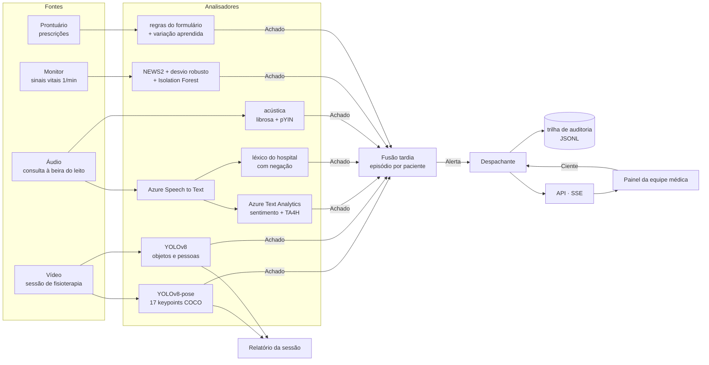
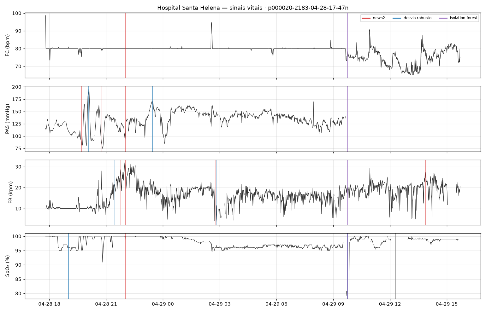
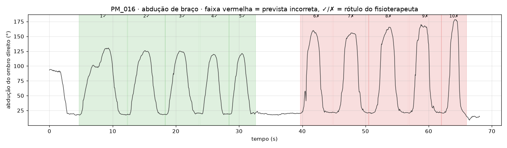

# Relatório Técnico — Tech Challenge Fase 4

**Monitoramento multimodal de pacientes: vídeo, áudio, sinais vitais e prescrições, com alertas à equipe médica em tempo real**
FIAP Postech — IA para Devs | Hospital Santa Helena (fictício) | 2026

Repositório: <https://github.com/otaviano/fiap-tech-challenge-fase4>

---

## 1. Introdução e contexto

Esta é a quarta fase de uma linha contínua:

- a **Fase 1** construiu um classificador de câncer de mama;
- a **Fase 2** o otimizou por algoritmo genético e trouxe um LLM local;
- a **Fase 3** transformou o LLM em assistente clínico, com alertas
  determinísticos e trilha de auditoria.

Nesta fase, o Hospital Santa Helena passa a **monitorar pacientes
continuamente** e a juntar o que cada fonte de dado observa num único alerta
para a equipe médica.

O enunciado pede três entregas técnicas:

| # | Entrega | O que foi construído |
|---|---|---|
| 1 | **Vídeo** com OpenPose e YOLOv8, e relatórios automáticos de desvios | Análise de sessões de fisioterapia (REHAB24-6): execução incorreta, outra pessoa na área do paciente, queda e um relatório por sessão |
| 2 | **Áudio** com Azure Speech to Text e Azure Text Analytics, e alterações vocais | Consultas transcritas pelo Azure; termos críticos com negação, sentimento e Text Analytics for Health; fala ofegante e fadiga medidas contra o basal do paciente |
| 3 | **Anomalias** em sinais vitais, prescrições e movimentação, com alertas à equipe | NEWS2, desvio robusto e Isolation Forest em 336 h de UTI; regras de formulário e variação de dose aprendida; fusão multimodal, painel em tempo real e ciência auditada |

**Premissa que atravessa o projeto:** *os modelos observam e a fusão decide.*
Cada analisador produz **achados**: uma observação com escore, fonte e
evidência. Nenhum deles aciona a equipe diretamente. Quem decide se um achado
vira **alerta**, com qual severidade e para quem, é um motor de regras
explícito. Ele leva em conta a concordância entre fontes independentes e herda
da Fase 3 a escala de severidade e a trilha de auditoria. É o mesmo princípio
da Fase 3, em que o LLM redigia e não decidia: a parte que precisa de garantia
fica em código determinístico e testável.

### Ambiente e restrições reais

| Recurso | Situação | Consequência |
|---|---|---|
| GPU | nenhuma com CUDA | YOLOv8-pose no lugar do OpenPose original (decisão D1) |
| CPU / RAM | 8 núcleos / 30 GB | pose a 36 quadros/s em CPU; avaliações paralelizadas |
| Nuvem | Azure for Students: US$ 100/ano, política restrita a 5 regiões | Speech e Language na camada **F0 (gratuita)** em `brazilsouth` |
| Dados de paciente | nenhum dado real disponível (LGPD) | datasets públicos anonimizados (MIMIC-III, REHAB24-6) e dados sintéticos com rótulo |

---

## 2. Fluxo multimodal



### Dois contratos

- **`Achado`** (`domain.py`): a saída de todo analisador. Tem paciente,
  modalidade, tipo, escore de 0 a 1, fonte (o modelo ou serviço que o
  produziu), evidência e momento.
- **`Alerta`**: a saída da fusão. Tem severidade (crítico, alto, moderado ou
  informativo), mensagem, os ids dos achados que o fundamentam, as modalidades
  envolvidas e o destinatário.

Nenhum analisador conhece os outros, e a fusão não conhece nenhum SDK. Isso
permite:
- testar cada peça isoladamente;
- ligar uma modalidade nova pelo endpoint `POST /achados`, sem tocar na fusão;
- continuar monitorando quando uma modalidade cai. Se o Azure falhar, o monitor
  e o vídeo seguem.

### Fusão tardia, e por quê

As modalidades têm taxas muito diferentes:
- o monitor gera um ponto por minuto;
- a consulta, alguns minutos de áudio por dia;
- o vídeo, uma sessão;
- a prescrição, um evento por revisão.

Também têm latências, confiabilidades e formas de falhar diferentes. Fundir no
nível de *feature* exigiria alinhar tudo isso num vetor comum e perderia a
explicação. Fundir no nível de **achado** (*late fusion*, decisão D2) mantém
cada evidência legível ("SpO2 89,5%", "fala ofegante", "morfina 10× a dose
anterior") e deixa explícita a regra que transformou essas evidências em
alerta. O detalhamento está na seção 4.

### Tempo real

O monitoramento é demonstrado por **replay acelerado** (decisão D3):
- 6 leitos reproduzem registros reais do MIMIC-III minuto a minuto, de 60× a
  600×;
- os detectores são *streaming* de verdade: um ponto por vez, sem olhar o
  futuro;
- o servidor (FastAPI) envia vitais, alertas e reconhecimentos ao painel por
  **Server-Sent Events**.

O mesmo código rodaria sobre o feed de um monitor real. Só a fonte é gravada.

---

## 3. Modelos por tipo de dado

| Dado | Fonte | Modelos e serviços | Saída (achados) |
|---|---|---|---|
| Sinais vitais | MIMIC-III Waveform Matched Subset: 10 pacientes, 336 h | NEWS2 parcial · z robusto (mediana/MAD) contra o basal do paciente · Isolation Forest por paciente | `news2_*`, `desvio_*`, `multivariado`, `sensor_sem_sinal` |
| Áudio: como o paciente fala | consultas gravadas (basal + atual) | librosa, pYIN (vozeamento e F0), núcleos silábicos, comparação com o basal | `fala_ofegante`, `fadiga_vocal` |
| Áudio: o que o paciente diz | transcrição | **Azure Speech to Text** (pt-BR) · léxico do hospital com negação · **Azure Text Analytics**: sentimento com opinion mining e Text Analytics for Health | `termo_critico`, `sintoma_relatado`, `sentimento_negativo` |
| Vídeo: postura | REHAB24-6 (fisioterapia) | **YOLOv8n-pose** (17 keypoints do modelo COCO do OpenPose) · ângulos articulares · regressão logística | `desvio_execucao`, `amplitude_reduzida`, `queda` |
| Vídeo: objetos e áreas | REHAB24-6 | **YOLOv8n** (objetos COCO) · área do paciente | eventos de área crítica no relatório |
| Prescrições | internações sintéticas no formato do prontuário da Fase 3 | regras do formulário · distribuição robusta da variação de dose por medicamento | `erro_decimal`, `dose_acima_maxima`, `duplicidade`, `ajuste_atipico`… |

### 3.1 Sinais vitais

**Dados.** O MIMIC-III Waveform Database Matched Subset (PhysioNet) traz os
registros numéricos do monitor de beira de leito de UTI: uma amostra por minuto
de FC, pressão arterial invasiva, FR e SpO2. Curamos 10 registros, um por
paciente, de 8 a 72 h cada, somando **336 h**. Eles têm o que um dataset
didático não tem:
- SpO2 = 0 com o sensor solto em até 63% de um registro;
- picos de *flush* da linha arterial;
- FC travada em 80 por marcapasso;
- buracos sem sinal.

**Pipeline.** Um **filtro de artefato** transforma valores fisiologicamente
implausíveis em "sem dado". Se o sinal fica mudo por 10 min, ele emite um
aviso técnico, não clínico. Depois do filtro, três detectores complementares
respondem a perguntas diferentes:

| Detector | Pergunta | Técnica |
|---|---|---|
| **NEWS2** | "Este valor é perigoso para *qualquer* adulto?" | tabela do NEWS2 (RCP, 2017): parâmetro com 3 pontos ou agregado ≥ 5 / ≥ 7, com persistência de 3 min. É **parcial**: o monitor numérico tem 4 dos 7 parâmetros |
| **Desvio robusto** | "Este valor é estranho *para este paciente*?" | z robusto (mediana/MAD) contra as últimas 2 h, com 10 min de atraso para o evento não contaminar a referência. Dispara com \|z\| ≥ 4 **e** uma mudança mínima absoluta (FC 15 bpm, PAS 20 mmHg, FR 6 irpm, SpO2 4 pp) |
| **Isolation Forest** | "Esta *combinação* é estranha?" | um modelo por paciente, treinado nas primeiras 3 h e retreinado a cada hora. O limiar é o quantil 0,5% dos escores do basal |

Nenhum detector dispara a cada minuto enquanto a condição dura. Cada um exige
persistência para disparar e um período sem a condição para rearmar, o que dá
**um achado por episódio**. Todo achado leva sua evidência: valor, basal, z,
pontos NEWS2 por parâmetro e, no Isolation Forest, os sinais que mais se
afastaram do basal.

### 3.2 Áudio das consultas

O **Azure** responde *o que* o paciente disse, e a **acústica** responde *como*
ele disse. Um paciente que diz "estou bem" com a fala entrecortada de quem está
sem ar é justamente o caso que o texto sozinho perde.

**Transcrição.** O Azure Speech to Text faz reconhecimento contínuo em pt-BR,
com tempo e confiança por palavra.

**Texto.** A transcrição passa por duas análises:
- **Léxico do hospital:** 7 categorias com escore por urgência. Risco de
  autolesão vale 0,95 e é sempre crítico; respiratório, cardiovascular e
  neurológico valem 0,80. O léxico inclui coloquialismos, como "coração
  disparado" e "puxando o ar". Ele **trata negação**: "não tenho falta de ar"
  não vira achado. A regra é um marcador de negação até 3 palavras antes do
  termo, na mesma oração. É a lição da Fase 2, em que ignorar a negação
  reprovava respostas corretas.
- **Azure Text Analytics:** o **sentimento com opinion mining** (pt-BR) vira um
  sinal de apoio de baixa severidade. O **Text Analytics for Health** (`pt`)
  extrai entidades clínicas com **asserção**, incluindo a negação. Um termo que
  o léxico e o Azure encontram juntos é marcado como corroborado
  (`lexico-hospital+azure-ta4h`).

**Acústica.** Cada medida é comparada com o **basal do próprio paciente**:

| Medida | Sinaliza |
|---|---|
| grupo de fala médio, pausas por minuto | dispneia: o paciente para para respirar |
| inspirações audíveis por minuto | dispneia: respiração audível entre as frases |
| voz soprosa (planicidade espectral) | dispneia |
| taxa de articulação (núcleos silábicos por segundo de fala) | fadiga: fala lenta |
| F0 e variabilidade (pYIN), intensidade | fadiga: voz grave, monótona e fraca |

Quatro decisões de método definem a qualidade do detector:

1. **Fala é energia com vozeamento.** Um detector de voz só por energia
   confunde a respiração audível com fala e enxerga *menos* pausas justamente
   no paciente dispneico. A primeira versão detectou 1 caso de dispneia leve
   em 12. Com o vozeamento do pYIN separando voz de sopro, passou a 12 em 12.
2. **Respiração não é fricativa.** "S", "f" e "ch" também não têm voz. Uma
   inspiração só conta se for ≥ 6 dB mais fraca que a fala e tiver centroide
   < 3 kHz.
3. **Basal do paciente e ≥ 2 critérios.** Valores absolutos dependem do
   microfone, da sala e do falante. O que é clínico é a mudança. Pausas a mais
   com fala lenta e sem respiração audível são atribuídas à **fadiga**: na
   dispneia, a articulação dentro de cada grupo de fala continua no ritmo
   normal.
4. **Fala fragmentada sozinha não é falta de ar.** Grupos curtos e pausas
   frequentes medem o mesmo fenômeno. A fala ofegante exige também um sinal
   respiratório (seção 6.2).

### 3.3 Vídeo das sessões de fisioterapia

**Dados.** O REHAB24-6 (Zenodo 13305826, CC BY-NC 4.0) tem 65 gravações de 6
exercícios, feitas por 10 pessoas com duas câmeras. Cada repetição tem o rótulo
**correta/incorreta** de um fisioterapeuta. Avaliamos dois exercícios de planos
diferentes: abdução de braço (frontal) e agachamento (sagital). São 22 vídeos e
373 repetições. A câmera é escolhida automaticamente pelo plano do movimento.

O `videos.zip` tem 2,65 GB, e o Zenodo serve a cerca de 340 KB/s. Como o índice
de um zip fica no fim do arquivo e o servidor aceita HTTP *Range*, o
`RemoteZip` lê só o índice e baixa **apenas os 22 vídeos**: 475 MB.

**OpenPose → YOLOv8-pose (decisão D1).** O OpenPose original exige build com
CUDA, e a máquina não tem GPU. O YOLOv8-pose produz **os mesmos 17 keypoints do
modelo COCO do OpenPose**, roda a **36 quadros/s em CPU** e vem no mesmo pacote
do YOLOv8 de objetos, o que dá um único runtime para as duas análises. O
MediaPipe (33 pontos) foi descartado para não misturar formatos de esqueleto.

**Pipeline.**
1. A pose é estimada a 15 Hz.
2. O **paciente** é rastreado: a maior pessoa no primeiro quadro e, depois, a
   detecção mais próxima dele.
3. Ângulos articulares são calculados por quadro: abdução do ombro, extensão do
   cotovelo, joelhos, quadril, inclinação do tronco e as compensações.
4. Cada repetição gera métricas: mínimo, máximo, amplitude, duração e
   hesitações.
5. Uma **regressão logística** treinada em *outras* pessoas dá a
   P(incorreta).
6. A **explicação** vem do z de cada métrica contra as execuções corretas.

Em paralelo:
- o YOLOv8 de objetos roda a 1 quadro/s;
- a **área crítica** é outra pessoa com pelo menos 20% da caixa dentro da
  região do paciente;
- a **queda** é o quadril na altura dos pés com o corpo deitado por ≥ 1 s.

**Relatório automático.** Cada sessão gera Markdown, JSON e um gráfico com:
- as repetições, cada uma com probabilidade, rótulo do fisioterapeuta e desvios
  explicados;
- a comparação de amplitude com a sessão anterior do mesmo paciente;
- os objetos em cena e os eventos de área crítica.

### 3.4 Prescrições

Prescrições reais não são públicas. Por isso geramos **internações
sintéticas** no formato do prontuário da Fase 3:
- um formulário ilustrativo com 19 medicamentos, dose máxima, intervalos,
  alta vigilância (ISMP) e limiar de desmame;
- uma evolução normal (titulação de insulina, desmames, suspensões);
- raros **escalonamentos legítimos**, para deixar a avaliação honesta;
- 7 tipos de anomalia rotulados.

| Detector | Pergunta | Técnica |
|---|---|---|
| **Regras do formulário** | "Viola algo que o hospital definiu?" | dose acima da máxima; razão ≥ 8× (provável vírgula); duplicidade de classe; suspensão sem desmame; intervalo 3× diferente; dose diária ≥ 2× |
| **Variação aprendida** | "É atípico *para este medicamento*?" | distribuição robusta do log da razão de dose diária, aprendida em 600 internações; \|z\| ≥ 3,5 |

A variação típica aprendida mostra por que um limiar único não serve. A
insulina varia ±41% normalmente, e o clonazepam em desmame varia ±19%. Uma
regra adicional evita alerta repetido: **a correção não é um novo erro**.
Quando a dose volta ao normal depois de um alerta, o detector entende que é a
resposta ao alerta e não dispara de novo.

---

## 4. Fusão multimodal e alertas

### 4.1 Severidade base

| Origem | Severidade base |
|---|---|
| NEWS2: parâmetro com 3 pontos / agregado ≥ 5 / agregado ≥ 7 | moderado / alto / **crítico** |
| Desvio do basal do paciente | pelo escore, com **teto moderado** |
| Relato de risco de autolesão | **crítico**, sem esperar corroboração |
| Queda no vídeo | alto |
| Erro decimal, dose acima da máxima | alto |
| Demais achados de prescrição | moderado |
| Desvio de execução, amplitude reduzida | no máximo moderado |
| Outras fontes (áudio, texto) | pelo escore: ≥ 0,8 alto · ≥ 0,5 moderado |

### 4.2 Canais físicos e concordância

Cada modalidade pertence a um **canal físico**, que é a origem do dado:
**monitor** (sinais vitais), **consulta** (áudio e texto), **câmera** (vídeo e
movimentação) e **prontuário** (prescrições).

- **Corroboração no mesmo canal:** dois ou mais detectores diferentes elevam um
  nível, **até no máximo *alto***. Os três detectores de sinais vitais leem o
  mesmo sensor: um oxímetro reposicionado engana os três ao mesmo tempo. Áudio
  e texto saem da mesma gravação. Em ambos os casos a concordância é evidência,
  mas não independente.
- **Concordância entre canais:** fontes independentes elevam mais um nível,
  **sem teto**.

O resultado é que **um alerta só é crítico com NEWS2 ≥ 7, com relato de risco
de autolesão ou com canais físicos que concordam.**

### 4.3 Validade, episódio e destinatário

- **Validade da evidência:** o monitor vale 15 min, a consulta e o vídeo valem
  1 h e a prescrição vale **6 h**, porque o risco dura enquanto o medicamento
  age. É isso que liga uma morfina errada às 08:00 à depressão respiratória das
  08:31.
- **Episódio:** começa no primeiro achado e continua aberto enquanto houver
  evidência vigente. Dentro dele, **só sai alerta novo se a severidade subir**
  (`ESCALONAMENTO`). Repetir a mesma condição não gera alerta.
- **Destinatário:**

  | Severidade ou tipo | Quem recebe |
  |---|---|
  | crítico | time de resposta rápida |
  | alto | médico plantonista |
  | moderado | enfermagem do leito |
  | prescrição | farmácia clínica, ou o médico prescritor e a farmácia clínica |
  | execução e amplitude | fisioterapia |

### 4.4 Despacho, resposta e auditoria

O despachante:
- grava cada alerta numa **trilha de auditoria JSONL**, com `trace_id` e os ids
  dos achados, herdada da Fase 3;
- publica no barramento que alimenta o painel (SSE);
- opcionalmente, envia a um webhook (Teams, Slack, pager) a partir de uma
  severidade mínima.

No painel, o profissional se identifica e clica em **Ciente**. A ciência é
auditada com quem deu ciência e os **segundos até a resposta**, e não pode ser
sobrescrita. A trilha permite reconstruir o caminho
`achado → alerta_emitido → alerta_reconhecido` de qualquer alerta.

---

## 5. Integração com o Azure

**Infraestrutura como código** ([`infra/`](infra/), Terraform `azurerm ~> 4.0`):
- um grupo de recursos;
- **Azure AI Speech** e **Azure AI Language**, ambos na camada **F0** em
  `brazilsouth`;
- um orçamento opcional com alerta por e-mail em 50% e 90% de US$ 20.

As credenciais ficam num `.env` fora do controle de versão.

**Orçamento (decisão D7).** O F0 não tem cobrança excedente: passou da cota, a
chamada é recusada. A cota mensal é de 5 h de transcrição e 5.000 registros de
texto, e o uso do projeto (menos de 2 h de áudio e cerca de 300 registros) cabe
com folga. **Custo efetivo: zero.**

**Duas descobertas de uso real:**
- A assinatura Azure for Students tem uma política que só permite 5 regiões. O
  `eastus` planejado para o Language foi recusado (`RequestDisallowedByAzure`),
  e as regiões permitidas foram consultadas com `az policy assignment list`.
  **O Text Analytics for Health funciona em `brazilsouth` na camada F0**, o que
  era uma dúvida aberta.
- O Text Analytics for Health aceita português apenas pela tag genérica `pt`
  (decisão D5). Sentimento e entidades usam `pt-BR`.

**Modo offline declarado (decisão D4).** Sem credenciais, os clientes Azure não
fingem:
- a transcrição cai para o roteiro `.txt`, quando existe;
- o texto passa só pelo léxico;
- o relatório registra em `servicos` o que foi de fato chamado.

Se o Azure falha no meio do plantão, o evento aparece como "falhou" no painel,
a falha vai para a auditoria e o monitoramento segue.

| Consulta | Speech to Text | Text Analytics for Health | Achados |
|---|---|---|---|
| PRT-2026-200102, dispneia | confiança 0,81–0,93 | "falta de ar", "peito apertado", "canso", "ar não chega" | fala ofegante (0,90) + termos críticos corroborados + sentimento negativo |
| PRT-2026-200103, fadiga | confiança 0,89 | "cansada", "sem força", "calafrio", "febre", "fraqueza" | fadiga vocal (0,75) + termos críticos + sentimento negativo |
| PRT-2026-200105, estável | confiança 0,87–0,93 | "falta de ar", "dor no peito" e "febre" **negados** | **nenhum achado** |

---

## 6. Resultados

Cada componente foi avaliado contra um *ground truth*: rótulos do dataset ou
eventos injetados com posição conhecida. Avaliar só pela demonstração mostraria
que o sistema funciona, mas não **com que frequência** ele erra.

### 6.1 Sinais vitais

Eventos conhecidos foram **injetados sobre o fundo real**: taquicardia,
bradicardia, hipotensão, dessaturação, taquipneia e uma **deterioração
combinada** em que cada sinal isolado fica perto do normal. Também injetamos
artefatos de sensor. Foram 3 sementes × 10 registros, com **139 eventos
avaliados**. Os 29 eventos que caíram em trechos com o sensor desconectado
foram descartados.

| Detector | Recall | Latência mediana | Achados por artefato | Carga sem injeção / 24 h |
|---|---|---|---|---|
| NEWS2 | 72% | 7 min | 0 | 11,2 |
| Desvio robusto | 80% | 6 min | 0 | 3,6 |
| Isolation Forest | 21% | 13 min | 0 | 1,5 |
| **Sistema (união)** | **96%** | **5 min** | **0** | 16,3 |

| Recall por tipo | taquicardia | bradicardia | hipotensão | dessaturação | taquipneia | deterioração combinada |
|---|---|---|---|---|---|---|
| NEWS2 | 64% | 50% | 63% | 96% | 80% | 81% |
| Desvio robusto | 100% | 88% | 42% | 87% | 73% | 81% |
| Isolation Forest | 16% | 12% | 21% | 17% | 13% | **62%** |
| **Sistema** | 100% | 92% | 95% | 96% | 97% | 100% |

**Leitura:**
- **Nenhum detector basta sozinho.** Eles erram em lugares diferentes: o NEWS2
  perde a taquicardia abaixo de 131 bpm, e o desvio robusto perde a hipotensão
  quando a PA invasiva é ruidosa.
- **O Isolation Forest é especialista:** pega 62% da deterioração combinada e
  12–21% dos eventos de um sinal só.
- **Os 5 eventos perdidos têm causa identificada:**
  - basais muito variáveis: FC com MAD de 11–24 bpm, em que uma queda de 32 bpm
    fica dentro do ruído do próprio paciente;
  - basal deslocado: PAS com mediana 147, em que uma queda de 38 mmHg termina
    em valores normais para qualquer adulto.
- Um Isolation Forest mais permissivo (quantil 2%) leva o sistema a 98%, com
  26% mais achados por dia. É uma decisão de produto entre o custo de um evento
  perdido e a fadiga de alarme. Ela muda com uma flag, e mantivemos o limiar
  conservador.

**Achados fora de evento não são falsos positivos.** Em UTI, o paciente tem
anomalias reais sem rótulo. Por isso medimos a **carga** no registro sem
injeção: 16,3 achados por paciente-dia. É a fusão (seção 4) que transforma
achados em alertas. Nas primeiras 3 h do plantão demonstrado, os 6 leitos
geraram **10 alertas**. Os 3 eventos injetados foram alertados em 3 a 5 min, e
os demais alertas vieram de eventos reais dos pacientes: taquipneia, NEWS2 ≥ 5
e FR acima do basal.

### 6.2 Áudio

Não existe dataset público de consultas em pt-BR com rótulo de fadiga ou
dispneia. Por isso geramos consultas de **condição conhecida** com as **vozes
neurais do Azure**: 4 vozes, prosódia em SSML, 3 roteiros por condição sempre
diferentes do roteiro do basal, versões leves de cada alteração e ruído de sala.

| Condição | Com basal | Sem basal |
|---|---|---|
| normal | **0/12 falsos alarmes** | 0/12 falsos alarmes |
| fadiga | **11/12**, 0 confusões | 0/12 |
| fadiga leve | 1/12 | 0/12 |
| dispneia | **12/12**, 0 confusões | 12/12 |
| dispneia leve | **12/12**, 0 confusões | 12/12 |

**Leitura:**
- **A dispneia é detectada em todos os casos, com e sem basal.** Respiração
  audível entre frases curtas é anormal em qualquer pessoa.
- **A fadiga só aparece com basal.** Fala lenta não é anormal por si só, e o
  que é clínico é a mudança. Isso sustenta a recomendação de gravar uma
  consulta basal na admissão.
- **A fadiga leve** fica dentro da variação natural de uma mesma pessoa e
  quase não é detectada.

**Uma correção que veio da avaliação.** A primeira versão dava **2/12 falsos
alarmes** de fala ofegante com as vozes neurais. A causa era a **pontuação**,
não a voz. Os roteiros com muitas vírgulas fazem a voz natural pausar mais, e os
grupos de fala encurtavam cerca de 40% sem nenhuma respiração audível. "Grupos
curtos" e "pausas frequentes" medem o mesmo fenômeno e eram contados como dois
critérios independentes. Passamos a exigir um sinal respiratório (respiração
audível ou voz soprosa). Com isso:
- os falsos alarmes caíram para **0**, sem perder nenhuma das 24 dispneias;
- no espeak, o motor offline e robótico, a dispneia leve caiu de 12/12 para
  8/12 com basal. Nas vozes femininas dele, o detector mede pouca respiração
  audível.

Preferimos não alarmar com fala fragmentada sem sinal respiratório.

**A voz importa para o Speech to Text.** Com a voz robótica do espeak, o
serviço pulava trechos, com confiança de 0,5–0,6, e transcreveu "estou a ganhar
dinheiro" no lugar de "estou com falta de ar". Com voz neural, a transcrição
fica praticamente igual ao roteiro, com confiança de 0,81–0,93.

### 6.3 Vídeo

A validação **deixa uma pessoa de fora**: o modelo nunca é testado em alguém
que viu no treino, que é o cenário de um paciente novo.

| Exercício | Vídeos · pessoas | Repetições (incorretas) | AUC global | **AUC mediana por pessoa** | Sensibilidade | Especificidade |
|---|---|---|---|---|---|---|
| Abdução de braço | 12 · 8 | 168 (83) | 0,81 | **0,87** | 71% | 68% |
| Agachamento | 9 · 9 | 195 (61) | 0,64 | **0,95** | 59% | 67% |

**Leitura:**
- **O modelo ordena bem as repetições de cada paciente** (AUC mediana de 0,87 e
  0,95).
- **O limiar entre pessoas é o problema.** "Incorreto" é um erro diferente para
  cada pessoa. No PM_016, as repetições incorretas sobem o braço *mais*, e no
  PM_001 elas ficam *abaixo* das corretas. Isso derruba a AUC global do
  agachamento para 0,64. A consequência prática é **calibrar por paciente**: o
  fisioterapeuta marca uma ou duas repetições na primeira sessão.
- *Random forest* (AUC 0,75 / 0,57) e a normalização por sessão (0,79 / 0,63)
  não melhoraram. Ficamos com a regressão logística, que é mais simples e
  explicável.

**Outra pessoa em cena** (rótulo do dataset de 0 a 3):
- com grande parte de outra pessoa visível, sensibilidade de **83%** e
  especificidade de **96%**;
- um braço na borda é detectado em só 24%, porque o YOLOv8 detecta pessoas, não
  membros soltos.

A primeira versão da área crítica disparava em 49% das repetições sem ninguém,
enganada por um vulto escuro cortado na borda. Por isso separamos "pessoa
visível" (avaliada contra o rótulo) de "pessoa na área do paciente" (evento
clínico).

O REHAB24-6 não tem quedas. O detector de queda é testado com séries de pose
sintéticas: uma queda sustentada dispara, e um agachamento de 4 quadros não.

### 6.4 Prescrições

O modelo foi treinado em 600 internações sem anomalia e testado em **800
internações novas**, 60% delas com uma anomalia injetada:

| Detector | Ajuste atípico | Os outros 6 tipos | Recall total | Alertas em internações sem anomalia |
|---|---|---|---|---|
| Regras | 0/49 | 444/444 | 90% | 23/1.997 (1,1%) |
| **Regras + variação aprendida** | **9/49** | 444/444 | **92%** | 24/1.997 (**1,2%**) |

**Leitura:**
- Os 6 tipos "de regra" são 100% detectados. Isso mede a implementação, não a
  cobertura clínica.
- A variação aprendida é a única que alcança o **ajuste atípico**, uma dose 1,5
  a 1,9× no meio de um desmame, abaixo de qualquer limiar de regra.
- Quase todos os 23 alertas em internações normais são o escalonamento
  legítimo da enoxaparina: dose diária 4×. É exatamente o que um farmacêutico
  clínico quer conferir.

### 6.5 Síntese

| Requisito | Resultado principal |
|---|---|
| Vídeo: postura e desvios | AUC por pessoa 0,87 (braço) e 0,95 (agachamento); relatório automático por sessão |
| Vídeo: objetos e áreas | outra pessoa em cena: sensibilidade 83%, especificidade 96% |
| Áudio: alterações vocais | dispneia 24/24, fadiga 11/12, 0 falsos alarmes (com basal, vozes neurais) |
| Áudio: Azure | Speech to Text com confiança 0,81–0,93; negação respeitada pelo léxico e pelo Text Analytics for Health |
| Sinais vitais | recall 96%, latência mediana 5 min, 0 alertas por artefato |
| Prescrições | recall 92% com 1,2% de alertas em internações normais |
| Alertas | crítico só com NEWS2 ≥ 7, autolesão ou concordância entre canais; ciência auditada |

---

## 7. Exemplos de anomalias detectadas

### 7.1 Dessaturação real no monitor, com convergência dos três detectores

Registro `p000020`, 21,9 h sem nenhuma injeção:



- **Às 09:43, os três detectores convergem.** O NEWS2 marca SpO2 80% (NEWS2
  parcial 5), o desvio robusto marca a SpO2 15 MADs abaixo do basal e o
  Isolation Forest aponta a SpO2 como principal desvio.

  O trecho está colado num buraco de sinal e é seguido de SpO2 100%. Pode ser
  hipóxia ou o reposicionamento do sensor. É justamente o caso em que a fusão
  limita a severidade a *alto*: três detectores, um só sensor.
- **Às 02:47, bradipneia** (FR 3,5 irpm).
- **Às 19:42 e às 20:46, hipotensões** (PAS ~81) entre picos que parecem
  *flush* arterial.

### 7.2 Consulta: o que o paciente diz e como ele diz

O paciente PRT-2026-200102 foi transcrito pelo Azure:

> "falta de ar desde cedo. Qualquer coisa que eu falo já canso. Tentei levantar
> para ir ao banheiro e precisei parar no caminho, o peito apertado. Parece que
> o ar não chega…"

| Achado | Fonte | Evidência |
|---|---|---|
| `fala_ofegante` (0,90) | librosa | grupos de fala ≥ 35% mais curtos, pausas ≥ 50% mais frequentes e respiração audível ≥ 4/min acima do basal |
| `termo_critico` respiratório (0,85) | léxico + Azure TA4H | "falta de ar" |
| `termo_critico` cardiovascular (0,85) | léxico + Azure TA4H | "peito apertado" |
| `sintoma_relatado` | Azure TA4H | "ar não chega", "canso" |
| `sentimento_negativo` | Azure Language | confiança 0,95 |

O contraexemplo é o PRT-2026-200105: "Estou bem, doutor. **Não** tenho falta de
ar **nem** dor no peito. Dormi bem e **não** tive febre." Essa consulta tem
três termos críticos no texto, todos negados, e gera **nenhum achado**.

### 7.3 Sessão de fisioterapia com desvio de execução

Sessão PM_016, abdução de braço. Concordância com o fisioterapeuta: **10/10**.

| Rep. | P(incorreta) | Fisioterapeuta | Desvio explicado |
|---|---|---|---|
| 1–5 | 0,05–0,14 | correta | — |
| 6 | 0,92 | incorreta | extensão do cotovelo 29°, abaixo do padrão correto (147°, z = −9,8); elevação do braço oposto 5°, abaixo do padrão (22°, z = −3,1) |
| 7–10 | 0,88–0,95 | incorreta | o mesmo padrão: extensão do cotovelo de 20–27° (z ≤ −10) e braço oposto a 5° |

A amplitude mediana é **+20%** em relação à sessão anterior (PM_012). O achado
`desvio_execucao` vai para a **fisioterapia** como moderado, e não para a
enfermagem.



### 7.4 Erro de prescrição ligado ao efeito clínico

Leito UTI-05 da demonstração (seção 8):

| Horário | Canal | Achado | Alerta |
|---|---|---|---|
| 08:00 | prontuário | possível erro decimal: morfina 4 mg → 40 mg de 4/4 h (10×) | **alto**, para o médico prescritor e a farmácia clínica |
| 08:25 | monitor | depressão respiratória injetada (FR → 7 irpm, SpO2 → 88%) | — |
| 08:31 | monitor + prontuário | o monitor confirma o efeito | **crítico** (`ESCALONAMENTO`, concordância entre monitor e prontuário), para o time de resposta rápida |

Nenhum canal sozinho produziria o crítico. A prescrição vale 6 h na fusão, e o
monitor confirma o efeito 31 minutos depois.

---

## 8. Demonstração integrada

Um plantão de UTI em que **todas as modalidades entram na mesma fusão**, sempre
na mesma ordem ([`docs/demo.md`](docs/demo.md)). É o roteiro que o vídeo de
entrega mostra:

| Horário | Leito | Canal | Evento | Alerta |
|---|---|---|---|---|
| 07:20 | UTI-03 | monitor | deterioração combinada | moderado 07:25 → alto 07:31 |
| 07:45 | UTI-02 | monitor | dessaturação | moderado 07:48 |
| **07:52** | UTI-02 | **consulta** | fala ofegante, "falta de ar", "peito apertado" (Azure) | **crítico**: consulta + monitor, para o time de resposta rápida |
| **08:00** | UTI-05 | **prontuário** | morfina 4 → 40 mg | **alto**: prescritor e farmácia |
| 08:10 | UTI-04 | monitor | taquicardia | alto 08:15 |
| **08:25** | UTI-05 | monitor | depressão respiratória | **crítico** 08:31: monitor + prontuário |
| **08:45** | UTI-03 | **consulta** | fadiga vocal, "cansada", "febre" | moderado → alto |
| **09:00** | UTI-06 | **consulta** | "estou bem, não tenho falta de ar…" | **nenhum achado** |
| 09:13 | UTI-06 | monitor | NEWS2 6 (evento real do paciente) | alto |
| **09:20** | UTI-04 | **câmera** | fisioterapia PM_016: 5 de 10 repetições incorretas | moderado, para a fisioterapia |

O roteiro mostra quatro propriedades do sistema:
- **concordância entre canais:** dois críticos que nenhum canal produziria
  sozinho;
- **especificidade:** a negação é respeitada;
- **relato não substitui sinal:** o paciente diz que está bem e, 13 minutos
  depois, o monitor mostra NEWS2 6;
- **destinatário certo** para cada tipo de alerta.

Dois detalhes de engenharia tornam a demonstração reproduzível:
- **Relógio comum.** Os leitos andam juntos, minuto a minuto. Na primeira
  versão cada leito andava no próprio ritmo, que dependia do tempo de carga da
  série. A consulta das 07:52 chegava à fusão depois de achados das 07:56 e
  gerava um alerta fora de ordem.
- **O plantão pausa durante a análise.** Enquanto o Azure transcreve e analisa,
  por 12 a 28 s, os leitos esperam, e os achados recebem o horário do disparo.

---

## 9. Organização do código e testes

```
src/med_monitor/
├── domain.py, config.py, audit.py   # contratos Achado/Alerta, configuração, trilha de auditoria
├── dados/                           # PhysioNet, REHAB24-6 (download seletivo), sintéticos, prescrições
├── anomalias/                       # sinais vitais, prescrições, avaliação, gráficos
├── audio/                           # acústica, léxico, consulta, amostras, avaliação
├── azure/                           # clientes Speech e Language (com modo offline)
├── video/                           # pose, métricas, objetos, avaliação, relatório
├── fusao/                           # motor de fusão tardia
├── alertas/                         # despachante, barramento, canais
├── serving/                         # API FastAPI, SSE, simulador, demo, painel
└── cli.py                           # med-monitor
infra/                               # Terraform (Azure Speech, Language, orçamento)
```

A dependência aponta para o centro:
- os analisadores conhecem só `domain`;
- a fusão conhece só `domain`;
- os clientes Azure ficam isolados em `azure/`, atrás de uma interface que
  degrada para o modo offline.

**132 testes automatizados** cobrem os detectores de cada modalidade, a
negação, a fusão (tetos, concordância, validade, escalonamento), o despacho e a
auditoria, a API, o simulador e a demonstração (sincronia dos leitos, falha de
um canal, ordem do roteiro). A suíte roda **sem rede, sem Azure e sem os
datasets**.

---

## 10. Como reproduzir

```bash
python3 -m venv .venv && source .venv/bin/activate
pip install torch torchvision --index-url https://download.pytorch.org/whl/cpu
pip install -e ".[video,audio,anomalias,serving,dev]"
cp .env.example .env                       # credenciais Azure (opcional; ver infra/README.md)
pytest -q                                  # 132 testes

med-monitor vitais baixar && med-monitor vitais avaliar
med-monitor audio amostras && med-monitor audio avaliar
med-monitor video baixar && med-monitor video avaliar && med-monitor video relatorio PM_016
med-monitor prescricoes avaliar

med-monitor serve --port 8000              # http://localhost:8000 → "Iniciar demonstração"
```

---

## 11. Desafios enfrentados e soluções

**A detecção de voz enxergava a respiração como fala.** O primeiro detector de
pausas usava só energia. No paciente dispneico, a inspiração ruidosa preenche a
pausa, e o detector via *menos* pausas justamente onde elas deveriam aumentar:
pegou 1 de 12 dispneias leves. A correção foi exigir vozeamento (pYIN) para
contar como fala, o que levou a 12 de 12. Depois, as fricativas da fala lenta
viraram falsas "inspirações", e a energia e o centroide resolveram.

**A pontuação imitava a falta de ar.** Com as vozes neurais, roteiros com
muitas vírgulas geravam falsos alarmes (seção 6.2). A causa foi identificada
olhando critério por critério em cada caso. Deixamos de contar duas vezes o
mesmo fenômeno.

**O Speech to Text com voz sintética robótica era inutilizável.** Com o espeak,
a confiança ficava em 0,5–0,6 e havia trechos inteiros inventados. As amostras
passaram a ser geradas com as vozes neurais do próprio Azure (SSML com
prosódia), com cache local para não repetir chamadas.

**O Text Analytics for Health marcava estados bons como sintoma.** "Dormi bem"
voltava como entidade clínica. Um filtro de qualificador positivo ("bem",
"melhor", "normal", "tranquilo") descarta esses casos.

**A região do Azure foi recusada.** O `terraform apply` em `eastus` falhou por
uma política da assinatura acadêmica. As regiões permitidas foram consultadas e
tudo foi para `brazilsouth`, onde o Text Analytics for Health também funciona
no F0.

**A área crítica disparava por um vulto.** Contar qualquer pessoa no quadro
dava alarme em 49% das repetições sem ninguém. A solução foi separar "pessoa
visível" de "pessoa *na área do paciente*", com confiança e sobreposição
mínimas.

**A correção de um erro de prescrição gerava outro alerta.** Quando a morfina
de 40 mg voltava a 4 mg, o detector via uma queda de 10× e alertava de novo. A
regra "correção após alerta não é novo erro" resolveu.

**O dataset de vídeo levaria horas para baixar.** O download seletivo por HTTP
*Range* baixou 475 MB em vez de 2,65 GB.

**Alertas fora de ordem na demonstração.** Os leitos fora de sincronia
entregavam à fusão achados de minutos diferentes. Um relógio comum em *lockstep*
resolveu, e um teste garante que os leitos andam juntos.

---

## 12. Limitações e considerações éticas

- **Dados.** Nenhum dado real identificável de paciente foi usado. O MIMIC-III
  é anonimizado e de acesso aberto (ODbL); o REHAB24-6 tem licença CC BY-NC,
  de uso acadêmico. Consultas e prescrições são sintéticas. Os recalls medem a
  sensibilidade a formatos plausíveis de anomalia, não a desfechos clínicos
  reais.
- **Áudio.** A voz é sintética e as alterações são controladas, o que valida a
  *mecânica* do detector. A disartria fica coberta pelo texto ("fala
  enrolada"), não pela acústica. Para o vídeo de entrega, o ideal é gravar os
  roteiros com voz humana.
- **Vídeo.** Os ângulos são 2D e dependem da câmera. Avaliamos 2 dos 6
  exercícios. Cirurgia fica fora do escopo, já que o enunciado pede
  fisioterapia *ou* cirurgia.
- **Sinais vitais.** O NEWS2 é parcial (4 de 7 parâmetros) e foi desenhado
  para enfermaria. Em UTI, muitos pacientes ficam com escore alto de forma
  crônica.
- **Prescrições.** O formulário é ilustrativo. Interações, função renal e peso
  ficaram de fora.
- **Uso.** É um sistema de **apoio**: ele prioriza a atenção da equipe e não
  substitui o julgamento clínico. Em produção, exigiria validação clínica,
  aprovação regulatória (software como dispositivo médico) e adequação à LGPD
  para áudio e vídeo de pacientes, que são dados sensíveis.

---

## 13. Conclusão

A entrega cumpre as três frentes do enunciado:
- **vídeo**, com análise postural no formato do OpenPose, objetos e áreas
  críticas, e relatório automático de desvios;
- **áudio**, com Azure Speech to Text e Text Analytics rodando de verdade, e
  alterações vocais medidas contra o basal do paciente;
- **anomalias** em sinais vitais, prescrições e movimentação, que viram
  alertas em tempo real para a equipe certa.

O que sustenta o projeto é uma posição sobre **o que é um alerta**. Um alerta
não é a saída de um modelo. É uma decisão que pondera:
- a gravidade de cada achado;
- a idade da evidência;
- se as fontes que concordam são de fato independentes.

Três detectores lendo o mesmo oxímetro não valem o mesmo que um oxímetro e um
paciente que diz estar sem ar. Essa distinção é o que permite que o sistema
alerte com **96% de recall nos sinais vitais e 0 alertas por artefato**, e que
só chame o time de resposta rápida quando fontes independentes concordam.

**O que faríamos com mais tempo:**
- calibração por paciente no vídeo, com uma ou duas repetições marcadas pelo
  fisioterapeuta;
- gravação de consultas com voz humana e avaliação com clínicos;
- regras de prescrição com função renal e interações;
- avaliação da carga de alertas com a equipe de enfermagem, porque a fadiga de
  alarme só se mede com quem recebe os alertas.

---

## Referências

- Moody B, Moody G, Villarroel M, Clifford GD, Silva I. *MIMIC-III Waveform
  Database Matched Subset* (v1.0). PhysioNet, 2020.
  <https://doi.org/10.13026/c2294b>. Licença ODbL v1.0.
- Goldberger AL et al. *PhysioBank, PhysioToolkit, and PhysioNet*. Circulation
  101(23), 2000.
- Černek A, Sedmidubský J, Budíková P. *REHAB24-6: Physical Therapy Dataset for
  Analyzing Pose Estimation Methods*. SISAP 2024.
  [Zenodo 13305826](https://zenodo.org/records/13305826). Licença CC BY-NC 4.0.
- Royal College of Physicians. *National Early Warning Score (NEWS) 2*. 2017.
- Liu FT, Ting KM, Zhou ZH. *Isolation Forest*. ICDM 2008.
- de Jong NH, Wempe T. *Praat script to detect syllable nuclei and measure
  speech rate automatically*. Behavior Research Methods 41(2), 2009.
- Mauch M, Dixon S. *pYIN: A fundamental frequency estimator using
  probabilistic threshold distributions*. ICASSP 2014.
- Cao Z et al. *OpenPose: Realtime Multi-Person 2D Pose Estimation Using Part
  Affinity Fields*. IEEE TPAMI, 2019.
- Jocher G et al. *Ultralytics YOLOv8*, 2023. <https://github.com/ultralytics/ultralytics>.
- Microsoft. *Azure AI Speech* e *Azure AI Language* (Text Analytics for
  Health). Documentação oficial, 2026.
- ISMP. *Medicamentos potencialmente perigosos de uso hospitalar*. Lista de
  alta vigilância.

---

*FIAP Postech — IA para Devs | Tech Challenge Fase 4 | 2026*
