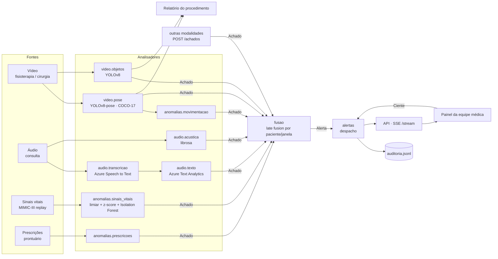

# Arquitetura — fluxo multimodal

## Contratos

- **`Achado`** (`domain.py`) — saída de todo analisador: paciente, modalidade,
  tipo, escore 0–1, fonte (modelo/serviço) e evidência.
- **`Alerta`** — saída da fusão: severidade (escala da Fase 3), mensagem, e os
  ids dos achados que o fundamentam. `multimodal=True` quando mais de uma
  modalidade concorda.

Nenhum analisador conhece os outros; a fusão não conhece nenhum SDK. Isso
permite testar cada peça isoladamente e rodar a demonstração mesmo com uma
modalidade fora do ar.

## Estado atual

- Sinais vitais → fusão → alertas → painel: **implementado** ([sinais vitais](sinais-vitais.md), [fusão e alertas](fusao-alertas.md)).
- Áudio, vídeo, prescrições e movimentação: entram na mesma fusão por `POST /achados` (ou chamando `MotorFusao.processar` direto) assim que os analisadores existirem.
