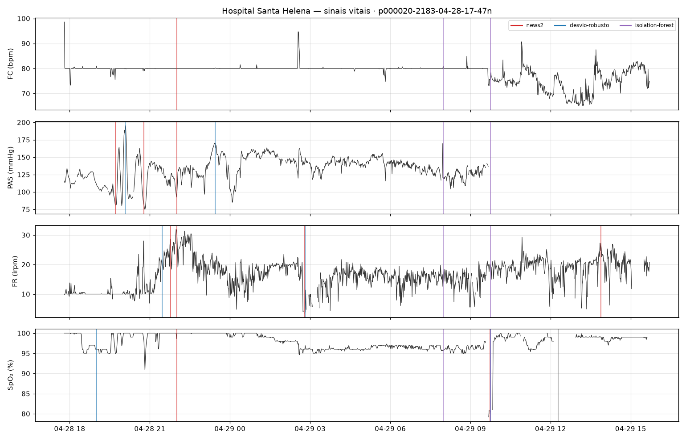
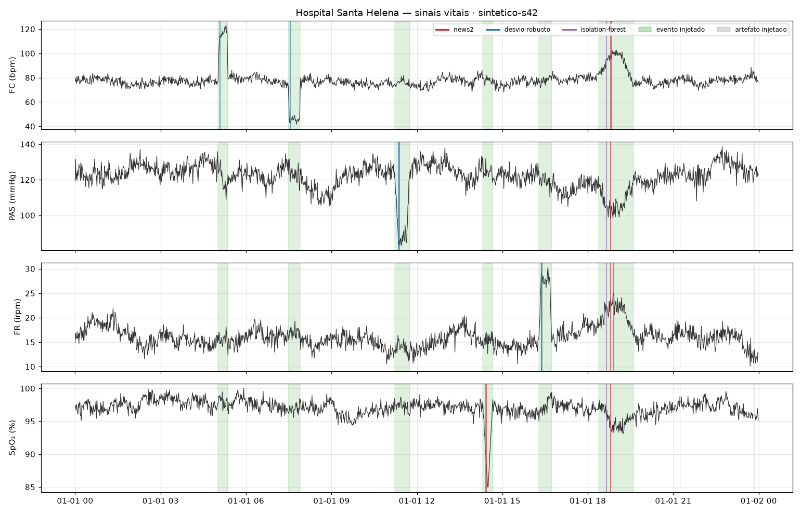

# Anomalias em sinais vitais

Entrega técnica 3.1 do enunciado: *"aplicar técnicas de detecção de anomalias
em séries temporais de sinais vitais (batimentos, pressão arterial,
oxigenação)"*. Código em [`src/med_monitor/anomalias/`](../src/med_monitor/anomalias/).

## Dados

**MIMIC-III Waveform Database Matched Subset** (PhysioNet), registros numéricos:
uma amostra por minuto do monitor de beira de leito de pacientes de UTI, com FC,
pressão arterial invasiva (sistólica, diastólica, média), frequência
respiratória e SpO2. Curamos 10 registros, um por paciente, de 8 a 72 h cada:
**336 h de monitoramento**. Ver `REGISTROS` em
[`dados/physionet.py`](../src/med_monitor/dados/physionet.py).

Os registros trazem o que um monitor real tem e um dataset didático não tem:
artefatos (SpO2 = 0 com o sensor solto em até 63% de um registro), picos de
*flush* da linha arterial, FC travada em 80 (marcapasso) e buracos sem sinal.

```bash
med-monitor vitais baixar          # baixa os 10 registros para data/external/physionet/
```

> Moody B, Moody G, Villarroel M, Clifford GD, Silva I. *MIMIC-III Waveform
> Database Matched Subset* (v1.0). PhysioNet, 2020. <https://doi.org/10.13026/c2294b>.
> Licença ODbL v1.0. Os dados não são redistribuídos neste repositório.

## Pipeline

```
amostra (1/min) ─▶ FiltroArtefato ─┬─▶ DetectorNEWS2 ──────────┐
                     │             ├─▶ DetectorDesvioRobusto ───┼─▶ Achado(SINAIS_VITAIS)
                     ▼             └─▶ DetectorMultivariado ────┘
             sensor_sem_sinal (aviso técnico)
```

Tudo é *streaming*: um ponto por vez, sem olhar o futuro. O mesmo código roda no
replay acelerado da demonstração e num feed de monitor.

### Filtro de artefato

Valores fisiologicamente implausíveis (FC fora de 20–250, SpO2 < 50, PAS fora
de 40–260, FR fora de 3–60…) viram "sem dado". Sinal mudo por 10 min gera um
aviso **técnico** `sensor_sem_sinal`, já que o monitoramento está cego. Esse
aviso não é um evento clínico.

### Três detectores complementares

| Detector | Pergunta | Técnica | Parâmetros |
|---|---|---|---|
| **NEWS2** | "Este valor é perigoso para *qualquer* adulto?" | Tabela do *National Early Warning Score 2* (RCP, 2017): parâmetro isolado com 3 pontos ou agregado ≥ 5 / ≥ 7 | persistência 3 min |
| **Desvio robusto** | "Este valor é estranho *para este paciente*?" | z robusto (mediana/MAD) contra o basal das últimas 2 h, com 10 min de atraso para o evento não contaminar a referência | \|z\| ≥ 4 **e** mudança absoluta mínima (FC 15 bpm, PAS 20 mmHg, FR 6 irpm, SpO2 4 pp); persistência 4 min |
| **Multivariado** | "Esta *combinação* de sinais é estranha?" | Isolation Forest por paciente, treinado nas primeiras 3 h e re-treinado a cada hora na janela das últimas 4 h | limiar = quantil 0,5% dos escores do basal; persistência 5 min |

- **NEWS2 parcial:** o NEWS2 tem 7 parâmetros e o monitor numérico só tem 4 (FR,
  SpO2, PAS e FC). Faltam consciência, temperatura e O2 suplementar, então o
  escore aqui é sempre menor ou igual ao real.
- **Anti-ruído de alarme:** nenhum detector dispara a cada minuto enquanto a
  condição dura. O `_Gatilho` exige persistência para disparar e um período sem
  a condição para rearmar, então é **um achado por episódio**.
- **Explicabilidade:** todo achado leva sua evidência. Isso inclui o valor e o
  basal do sinal, o z, os pontos NEWS2 de cada parâmetro e, no Isolation Forest,
  os sinais que mais se afastaram do basal (`principais_desvios`).

## Avaliação

Dados reais não têm rótulo de "aqui houve anomalia". Para medir recall e
latência, **injetamos eventos conhecidos sobre o fundo real**
([`dados/sintetico.py`](../src/med_monitor/dados/sintetico.py)): taquicardia (+38 bpm),
bradicardia (−32 bpm), hipotensão (PAS −38), dessaturação (até 85%), taquipneia
(+13 irpm) e **deterioração combinada**, com FC +20, PAS −20, FR +6 e SpO2 −3 ao
longo de 30 min, cada sinal isolado perto do normal. Também injetamos dois
**artefatos** de sensor por série. Isso dá 3 sementes × 10 registros, com eventos
em posições aleatórias depois de 3 h de aquecimento.

- **Recall:** há pelo menos um achado clínico entre o início do evento e o fim mais 10 min.
- **Latência:** minutos do início do evento até o primeiro achado.
- **Achados fora de evento / 24 h:** num paciente de UTI isso **não equivale a
  falso positivo**, porque ele tem anomalias reais sem rótulo. Por isso também
  medimos a carga no registro sem nada injetado.
- **Achados causados por artefato:** achados durante um artefato injetado que
  **não** aparecem no mesmo registro sem injeção.
- Eventos injetados num trecho em que o sensor estava desconectado (mais de 30%
  sem sinal) são descartados, porque mediriam o sensor e não o detector.

```bash
med-monitor vitais avaliar                       # ~10 min em 8 núcleos
```

### Resultados

139 eventos clínicos avaliados (29 descartados por sensor sem sinal), 336 h de
fundo real. Números completos em
[`results/anomalias/avaliacao_sinais_vitais.md`](../results/anomalias/avaliacao_sinais_vitais.md).

| Detector | Recall | Latência mediana | Fora de evento / 24 h | Por artefato | Carga sem injeção / 24 h |
|---|---|---|---|---|---|
| NEWS2 | 72% | 7 min | 9,5 | 0 | 11,2 |
| Desvio robusto | 80% | 6 min | 2,9 | 0 | 3,6 |
| Isolation Forest | 21% | 13 min | 0,9 | 0 | 1,5 |
| **Sistema (união)** | **96%** | **5 min** | 13,3 | **0** | 16,3 |

| Recall por tipo | taquicardia | bradicardia | hipotensão | dessaturação | taquipneia | deterioração combinada |
|---|---|---|---|---|---|---|
| NEWS2 | 64% | 50% | 63% | 96% | 80% | 81% |
| Desvio robusto | 100% | 88% | 42% | 87% | 73% | 81% |
| Isolation Forest | 16% | 12% | 21% | 17% | 13% | **62%** |
| **Sistema** | 100% | 92% | 95% | 96% | 97% | 100% |

**Leitura.**

- **Nenhum detector basta sozinho.** O melhor isolado chega a 80%, e a união a
  96%. Eles erram em lugares diferentes. O NEWS2 perde a taquicardia que fica
  abaixo de 131 bpm. O desvio robusto perde a hipotensão quando a PA invasiva é
  ruidosa.
- **O Isolation Forest é especialista.** Ele pega 62% da deterioração combinada,
  contra 12–21% dos eventos de um sinal só. A limitação é conhecida: cada corte
  da floresta sorteia uma variável, então um valor extremo em um único sinal fica
  pouco isolável. Para esses casos existem os outros dois detectores.
- **Artefato não vira alerta.** Foram zero achados causados pelos artefatos injetados.
- **Os 5 eventos perdidos** (de 139) têm causa identificada:
  - basal muito variável: FC com MAD de 11–24 bpm em p000124 e p000208, então
    uma queda de 32 bpm fica dentro do ruído do próprio paciente;
  - basal deslocado: a PAS de p000208 tem mediana de 147, e uma queda de 38 mmHg
    termina em ~109, normal para qualquer adulto.

**Teste com o Isolation Forest mais permissivo** (quantil 2%, persistência 3):

| | Recall do IF | Recall do sistema | Carga sem injeção / 24 h (sistema) |
|---|---|---|---|
| Padrão (0,5%, 5) | 21% | 96% (134/139) | 16,3 |
| Permissivo (2%, 3) | 48% | 98% (136/139) | 20,5 (+26%) |

Afrouxar o Isolation Forest mais que dobra o recall dele, mas quase tudo o que
ele passa a pegar os outros dois já pegavam. São +2 eventos para o sistema
(fecha as hipotensões e taquipneias que faltavam) ao custo de +4,2 achados por
paciente-dia. O padrão ficou no limiar conservador. A troca é uma decisão de
produto (custo de um evento perdido × fadiga de alarme) e muda com uma flag:
`med-monitor vitais avaliar --if-quantil 0.02 --if-persistencia 3`. Detalhes em
[`variacao_if_q002/`](../results/anomalias/variacao_if_q002/avaliacao_sinais_vitais.md).

### Exemplo real (sem injeção)

Registro `p000020-2183-04-28-17-47n`, 21,9 h:



- **Às 09:43, os três detectores convergem.** O NEWS2 registra dessaturação (SpO2
  80%, NEWS2 parcial 5), o desvio robusto marca SpO2 15 MADs abaixo do basal e o
  Isolation Forest aponta a SpO2 como principal desvio. Mas o trecho está colado
  num buraco de sinal e é seguido de SpO2 100%. Pode ser hipóxia real ou o
  reposicionamento do sensor. Distinguir os dois casos é tarefa da **fusão
  multimodal**, por exemplo com fala ofegante no áudio ou movimento no vídeo.
- **Às 02:47, há bradipneia** (FR 3,5 irpm), detectada pelo NEWS2 e pelo desvio robusto.
- **Às 19:42 e às 20:46, há hipotensões** (PAS ~81) entre picos que parecem
  *flush* da linha arterial (PAS 195).

Série sintética com os eventos injetados (faixas verdes) e os achados (linhas):



```bash
med-monitor vitais analisar --registro p000020-2183-04-28-17-47n --grafico
med-monitor vitais analisar --sintetico --grafico
```

## Limitações

- **População:** é de UTI (MIMIC). O NEWS2 foi desenhado para enfermaria, e em
  UTI muitos pacientes ficam com escore alto de forma crônica. O gatilho por
  episódio evita a repetição, mas o primeiro disparo acontece.
- **Formato dos eventos:** os eventos injetados têm formas plausíveis, porém
  sintéticas. O recall mede a sensibilidade a esses formatos, não a desfechos
  clínicos reais.
- **Carga de alarme:** cerca de 16 achados por paciente-dia é muito menos que o
  ruído de um monitor por limiar puro, mas ainda é bastante. É a fusão
  multimodal, com severidade e concordância entre modalidades, que transforma
  achados em **alertas**.
- **Artefatos plausíveis:** o filtro só remove o que é implausível. Um *flush*
  arterial (PAS 195) passa e pode gerar um achado.
