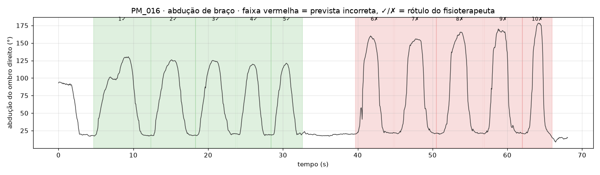

# Análise de vídeo das sessões de fisioterapia

Entrega técnica 1 do enunciado:
- processar vídeos clínicos;
- detectar movimentos ou eventos fora do padrão com **OpenPose** (postura) e
  **YOLOv8** (objetos e áreas críticas);
- gerar **relatórios automáticos** com os desvios do procedimento.

Também cobre a parte de vídeo da entrega 3.3, *padrões de movimentação do
paciente*. Código em [`src/med_monitor/video/`](../src/med_monitor/video/).

## Dados: REHAB24-6

Usamos 65 gravações de 6 exercícios, feitas por 10 pessoas com duas câmeras
ortogonais. Para **cada uma das 1.072 repetições** há o quadro inicial e final
e o rótulo **correta/incorreta** dado por fisioterapeuta. Esse rótulo é o
*ground truth* do detector. Licença CC BY-NC 4.0, citação no README.

**Recorte.** Avaliamos dois exercícios de planos de movimento diferentes:
- **abdução de braço (Ex1):** plano frontal, analisada com a câmera de frente;
- **agachamento (Ex6):** plano sagital, analisado com a câmera de lado.

A escolha da câmera é automática, pela orientação registrada no dataset
(`rehab24.camera_ideal`). São 22 vídeos e 373 repetições rotuladas.

**Download seletivo.** O `videos.zip` tem 2,65 GB e o Zenodo entrega a cerca
de 340 KB/s, o que levaria mais de 2 h. O índice de um zip fica no fim do
arquivo e o Zenodo aceita requisições HTTP *Range*. Então `RemoteZip` lê só o
índice e baixa **apenas os 22 vídeos** necessários: 475 MB em vez de 2,65 GB.

```bash
med-monitor video baixar            # só os vídeos dos exercícios 1 e 6
```

## Pipeline

```
vídeo ─▶ YOLOv8-pose (17 keypoints COCO) ─▶ rastreio do paciente ─▶ ângulos articulares por quadro
   │                                                                     │
   │                                     repetições (segmentação) ─▶ métricas por repetição
   │                                                                     │
   │                          regressão logística (treinada em OUTRAS pessoas) ─▶ P(incorreta)
   │                                                                     │
   ├─▶ outras pessoas (caixas) ─▶ área crítica do paciente               ├─▶ explicação (z vs execução correta)
   ├─▶ pose ─▶ queda (quadril no chão + corpo deitado ≥ 1 s)             │
   └─▶ YOLOv8 (1 quadro/s) ─▶ objetos em cena                            ▼
                                                     relatório da sessão (.md + gráfico) + Achados → fusão
```

### Postura: YOLOv8-pose no lugar do OpenPose (decisão D1)

O OpenPose original exige build com CUDA, e a máquina não tem GPU. O
YOLOv8-pose produz **os mesmos 17 pontos do modelo COCO do OpenPose**, roda a
**36 quadros/s em CPU** e vem no mesmo pacote do YOLOv8 de objetos. Processamos
1 de cada 2 quadros (15 Hz): os 22 vídeos saem em cerca de 12 min, com cache
em `data/processed/pose/`.

O **paciente** é a maior pessoa no primeiro quadro e, depois, a detecção mais
próxima dele no quadro anterior. Isso importa porque o REHAB24-6 tem quadros
com outras pessoas.

### Métricas por repetição

| Ângulo | Exercício | Definição |
|---|---|---|
| abdução do ombro | 1 | tronco (ombro→quadril) × braço (ombro→cotovelo) |
| extensão do cotovelo | 1 | ombro–cotovelo–punho |
| elevação do braço oposto, desnível dos ombros | 1 | compensações |
| joelhos, quadril | 6 | quadril–joelho–tornozelo · ombro–quadril–joelho |
| inclinação do tronco | 1, 6 | eixo meio-ombro→meio-quadril vs vertical |
| assimetria dos joelhos | 6 | \|joelho D − joelho E\| |

Para cada repetição calculamos o mínimo, o máximo e a amplitude (p95 − p5), a
duração e as **hesitações**, isto é, quantas vezes o ângulo principal inverte o
sentido com histerese de 3°. Uma repetição limpa tem 1 inversão (sobe e desce).

## Resultados: execução incorreta

**Validação por pessoa deixada de fora.** O modelo nunca é testado em alguém
que viu no treino, que é o cenário de um paciente novo.

| Exercício | Vídeos · pessoas | Repetições (incorretas) | AUC global | **AUC mediana por pessoa** | Sensibilidade | Especificidade |
|---|---|---|---|---|---|---|
| Abdução de braço | 12 · 8 | 168 (83) | 0,81 | **0,87** | 71% | 68% |
| Agachamento | 9 · 9 | 195 (61) | 0,64 | **0,95** | 59% | 67% |

AUC por pessoa:

| Exercício | Pessoas 1 a 9 |
|---|---|
| Abdução | 0,30 · 1,00 · 0,85 · 0,80 · 0,88 · — · 0,82 · 0,95 · 0,92 |
| Agachamento | 0,99 · 1,00 · 0,95 · 0,92 · 0,56 · 0,77 · 0,97 · 0,26 · 1,00 |

**Leitura.**

- **O modelo ordena bem as repetições de cada paciente** (AUC mediana de 0,87
  e 0,95). Ele sabe quais repetições daquela pessoa estão piores.
- **Errar o limiar entre pessoas** é o que derruba a AUC global do agachamento
  para 0,64. Os relatórios mostram a causa: *incorreto* é um erro diferente
  para cada pessoa.
  - No PM_016, as repetições incorretas sobem o braço **mais** (150–175°,
    provavelmente fora do plano).
  - No PM_001, elas ficam um pouco **abaixo** das corretas.
  - Um limiar único, aprendido em outras pessoas, não serve para todas.
- **Consequência prática:** calibrar por paciente. O fisioterapeuta marca uma
  ou duas repetições na primeira sessão, e o limiar se ajusta a ela. A
  ordenação já funciona sem isso.
- **Duas pessoas ficam invertidas** (a 1 no braço e a 8 no agachamento): o erro
  delas foi do tipo oposto ao da maioria. *Random forest* (AUC 0,75 / 0,57) e
  normalização por sessão (0,79 / 0,63) **não** melhoraram, e ficamos com a
  regressão logística, que é mais simples e explicável.
- **Qualidade da pose:** o PM_101 tem confiança média de 0,04 (iluminação) e é
  descartado automaticamente pelo filtro (pose válida em pelo menos 50% dos
  quadros).

```bash
med-monitor video avaliar           # pose (com cache) + métricas + validação por pessoa
```

## Resultados: outra pessoa em cena

O dataset rotula cada repetição de 0 (ninguém) a 3 (grande parte de outra
pessoa visível).

| Corte do rótulo | Positivos | Sensibilidade | Especificidade |
|---|---|---|---|
| grande parte de outra pessoa (3) | 6/373 | 83% | 96% |
| parte perceptível ou mais (≥ 2, ex.: um braço na borda) | 49/373 | 24% | 98% |

O YOLOv8 detecta **pessoas**, não membros soltos: é bom para "alguém entrou",
fraco para "um braço apareceu na borda". A amostra positiva do rótulo 3 é
pequena (6 repetições).

**Área crítica** é um conceito clínico nosso, sem rótulo no dataset: outra
pessoa, com confiança ≥ 0,6, com pelo menos 20% da caixa dentro da região
ocupada pelo paciente. Ela vira **evento no relatório**. A primeira versão,
que contava qualquer pessoa no quadro, disparava em 49% das repetições sem
ninguém, enganada por um vulto escuro cortado na borda. Por isso separamos
"pessoa visível" (avaliada contra o rótulo) de "pessoa na área do paciente"
(evento clínico).

## Relatório automático da sessão

`med-monitor video relatorio PM_016` gera um Markdown, um JSON e um gráfico em
`results/video/`. O relatório traz:
- as repetições, cada uma com a probabilidade de execução incorreta (modelo
  treinado **sem** aquela pessoa) e o rótulo do fisioterapeuta ao lado;
- a **explicação** de cada desvio, por exemplo: "inclinação do tronco 47°,
  acima do padrão correto (20°, z=+2,1)";
- a concordância com o fisioterapeuta e a **ordenação da sessão** (AUC das
  repetições daquele vídeo);
- a **comparação com a sessão anterior** do mesmo paciente (amplitude
  mediana);
- os objetos em cena e os eventos de área crítica.

| Sessão | Exercício | Concordância (limiar 0,5) | Ordenação da sessão | Destaque |
|---|---|---|---|---|
| [PM_016](../results/video/sessao_PM_016.md) | abdução | **10/10** | 1,00 | amplitude +20% vs PM_012 |
| [PM_022](../results/video/sessao_PM_022.md) | agachamento | 9/22 | **1,00** | a única incorreta é a pior, mas o limiar global marca outras 13 |
| [PM_029](../results/video/sessao_PM_029.md) | agachamento | 15/20 | 0,95 | outra pessoa na área do paciente aos 101,7 s, depois da última repetição |
| [PM_001](../results/video/sessao_PM_001.md) | abdução | 0/10 | 0,00 | **caso de falha**: pessoa 1, erro do tipo oposto ao das demais |



## Achados para a fusão

| Achado | Modalidade | Quando | Severidade na fusão |
|---|---|---|---|
| `desvio_execucao` | vídeo | ≥ 1 repetição prevista incorreta | no máximo moderado, para a **fisioterapia** |
| `amplitude_reduzida` | movimentação | amplitude ≥ 20% menor que a da sessão anterior | no máximo moderado, para a **fisioterapia** |
| `queda` | vídeo | quadril na altura dos pés e corpo deitado por ≥ 1 s | **alto**, para o médico plantonista; com outro canal, crítico |

```bash
med-monitor video relatorio PM_016 --api http://localhost:8000   # achados entram no painel
```

O REHAB24-6 não tem quedas. O detector de queda é testado com séries de pose
sintéticas: uma queda sustentada dispara, um agachamento de 4 quadros não.

## Limitações

- **Plano de imagem:** ângulos 2D dependem da câmera. Sessões em meio-perfil
  distorcem a abdução, por isso escolhemos a câmera pelo plano do movimento.
- **Recorte:** 2 de 6 exercícios. Os outros quatro rodam com o mesmo pipeline,
  bastando definir as métricas de cada um em `avaliacao.FEATURES`.
- **Cirurgia:** fora do escopo, já que o enunciado pede fisioterapia *ou*
  cirurgia.
