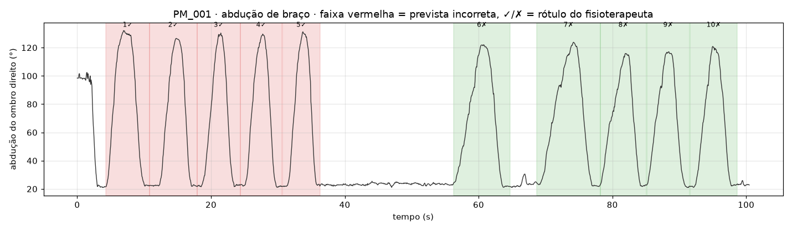

# Relatório da sessão PM_001

- **Exercício:** abdução de braço · câmera 17 · pessoa 1
- **Repetições:** 10 · **previstas incorretas:** 5 · concordância com o fisioterapeuta: 0/10 · ordenação das repetições (AUC da sessão): 0,00

- **Comparação com a sessão anterior** (PM_000): amplitude mediana 102° vs 144° (-30%)
- **Em cena:** cadeira (100%), pessoa (100%)

| Rep. | Intervalo | P(incorreta) | Fisioterapeuta | Desvios |
|---|---|---|---|---|
| 1 | 4.3–10.8 s | 0.60 | correta | duração da repetição 6s — acima do padrão correto (5s, z=+1,9) |
| 2 | 10.8–17.9 s | 0.50 | correta | duração da repetição 7s — acima do padrão correto (5s, z=+2,5) |
| 3 | 17.9–24.4 s | 0.51 | correta | duração da repetição 6s — acima do padrão correto (5s, z=+1,8) |
| 4 | 24.4–30.6 s | 0.51 | correta | duração da repetição 6s — acima do padrão correto (5s, z=+1,6) |
| 5 | 30.7–36.3 s | 0.60 | correta | — |
| 6 | 56.3–64.7 s | 0.26 | incorreta | — |
| 7 | 68.7–78.2 s | 0.35 | incorreta | — |
| 8 | 78.2–85.1 s | 0.46 | incorreta | — |
| 9 | 85.2–91.5 s | 0.38 | incorreta | — |
| 10 | 91.6–98.7 s | 0.30 | incorreta | — |

