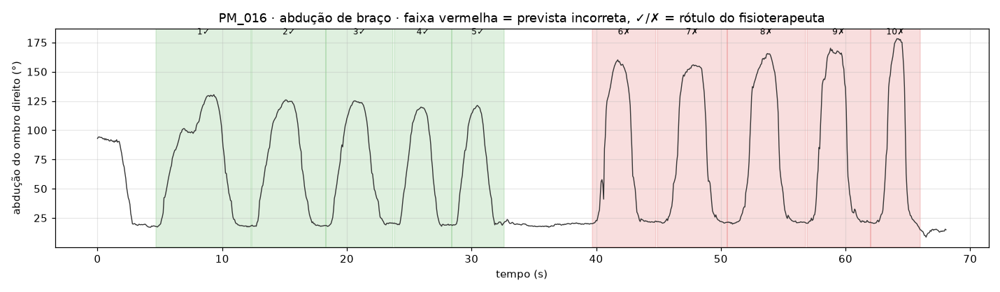

# Relatório da sessão PM_016

- **Exercício:** abdução de braço · câmera 17 · pessoa 2
- **Repetições:** 10 · **previstas incorretas:** 5 · concordância com o fisioterapeuta: 10/10 · ordenação das repetições (AUC da sessão): 1,00

- **Comparação com a sessão anterior** (PM_012): amplitude mediana 123° vs 102° (+20%)
- **Em cena:** pessoa (100%), cadeira (70%), mesa (7%), banco (3%)

| Rep. | Intervalo | P(incorreta) | Fisioterapeuta | Desvios |
|---|---|---|---|---|
| 1 | 4.7–12.3 s | 0.06 | correta | — |
| 2 | 12.4–18.3 s | 0.07 | correta | — |
| 3 | 18.3–23.7 s | 0.14 | correta | — |
| 4 | 23.8–28.4 s | 0.07 | correta | — |
| 5 | 28.4–32.6 s | 0.05 | correta | — |
| 6 | 39.7–44.8 s | 0.92 | incorreta | extensão do cotovelo 29° — abaixo do padrão correto (147°, z=-9,8); elevação do braço oposto 5° — abaixo do padrão correto (22°, z=-3,1) |
| 7 | 44.9–50.5 s | 0.95 | incorreta | extensão do cotovelo 21° — abaixo do padrão correto (147°, z=-10,5); elevação do braço oposto 5° — abaixo do padrão correto (22°, z=-3,1) |
| 8 | 50.5–56.8 s | 0.94 | incorreta | extensão do cotovelo 27° — abaixo do padrão correto (147°, z=-10,0); elevação do braço oposto 5° — abaixo do padrão correto (22°, z=-2,9) |
| 9 | 56.9–62.0 s | 0.95 | incorreta | extensão do cotovelo 20° — abaixo do padrão correto (147°, z=-10,6); elevação do braço oposto 5° — abaixo do padrão correto (22°, z=-2,9) |
| 10 | 62.0–66.0 s | 0.88 | incorreta | extensão do cotovelo 24° — abaixo do padrão correto (147°, z=-10,2); elevação do braço oposto 5° — abaixo do padrão correto (22°, z=-3,1) |

