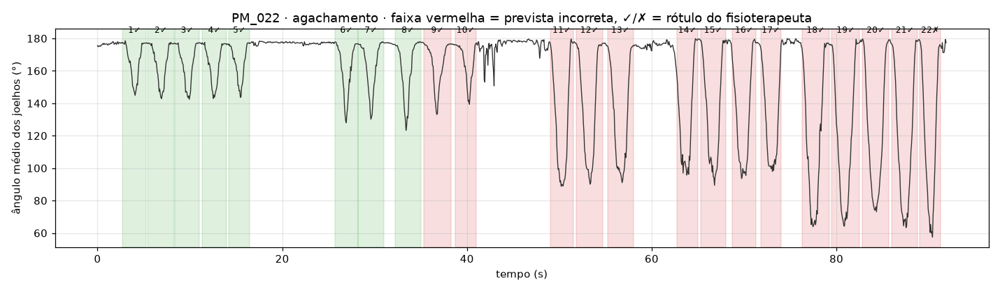

# Relatório da sessão PM_022

- **Exercício:** agachamento · câmera 17 · pessoa 2
- **Repetições:** 22 · **previstas incorretas:** 14 · concordância com o fisioterapeuta: 9/22 · ordenação das repetições (AUC da sessão): 1,00

- **Em cena:** pessoa (100%), cadeira (50%), mesa (3%), banco (2%)

| Rep. | Intervalo | P(incorreta) | Fisioterapeuta | Desvios |
|---|---|---|---|---|
| 1 | 2.7–5.3 s | 0.48 | correta | — |
| 2 | 5.4–8.3 s | 0.11 | correta | — |
| 3 | 8.4–11.0 s | 0.33 | correta | — |
| 4 | 11.3–14.0 s | 0.29 | correta | — |
| 5 | 14.2–16.5 s | 0.33 | correta | — |
| 6 | 25.7–28.2 s | 0.48 | correta | — |
| 7 | 28.2–31.0 s | 0.48 | correta | — |
| 8 | 32.2–35.0 s | 0.49 | correta | — |
| 9 | 35.3–38.3 s | 0.86 | correta | assimetria entre os joelhos 44° — acima do padrão correto (12°, z=+4,2); flexão do quadril (direito) 137° — acima do padrão correto (102°, z=+2,1) |
| 10 | 38.7–41.0 s | 0.97 | correta | assimetria entre os joelhos 53° — acima do padrão correto (12°, z=+5,4); flexão do quadril (direito) 145° — acima do padrão correto (102°, z=+2,6) |
| 11 | 49.0–51.5 s | 0.90 | correta | — |
| 12 | 51.8–54.7 s | 0.85 | correta | — |
| 13 | 55.2–58.0 s | 0.84 | correta | — |
| 14 | 62.7–65.0 s | 0.90 | correta | — |
| 15 | 65.3–68.0 s | 0.88 | correta | — |
| 16 | 68.7–71.3 s | 0.89 | correta | — |
| 17 | 71.8–74.0 s | 0.90 | correta | duração da repetição 2s — abaixo do padrão correto (4s, z=-1,6) |
| 18 | 76.3–79.2 s | 0.94 | correta | flexão máxima dos joelhos (ângulo mínimo) 65° — abaixo do padrão correto (107°, z=-1,7); amplitude dos joelhos 112° — acima do padrão correto (66°, z=+1,6) |
| 19 | 79.5–82.5 s | 0.94 | correta | amplitude dos joelhos 110° — acima do padrão correto (66°, z=+1,6); flexão máxima dos joelhos (ângulo mínimo) 67° — abaixo do padrão correto (107°, z=-1,6) |
| 20 | 82.8–85.7 s | 0.96 | correta | — |
| 21 | 86.0–88.8 s | 0.94 | correta | amplitude dos joelhos 114° — acima do padrão correto (66°, z=+1,7); flexão máxima dos joelhos (ângulo mínimo) 65° — abaixo do padrão correto (107°, z=-1,7) |
| 22 | 89.0–91.3 s | 0.98 | incorreta | flexão máxima dos joelhos (ângulo mínimo) 60° — abaixo do padrão correto (107°, z=-1,8); amplitude dos joelhos 116° — acima do padrão correto (66°, z=+1,8) |

