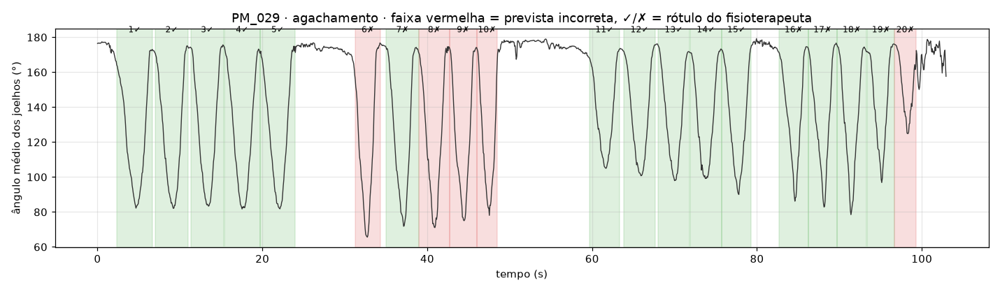

# Relatório da sessão PM_029

- **Exercício:** agachamento · câmera 18 · pessoa 3
- **Repetições:** 20 · **previstas incorretas:** 5 · concordância com o fisioterapeuta: 15/20 · ordenação das repetições (AUC da sessão): 0,95

- **Em cena:** pessoa (100%)
- **Áreas críticas:** pessoa na area 101.7–102.9 s (outra pessoa na área do paciente)

| Rep. | Intervalo | P(incorreta) | Fisioterapeuta | Desvios |
|---|---|---|---|---|
| 1 | 2.3–6.7 s | 0.16 | correta | — |
| 2 | 7.0–11.0 s | 0.16 | correta | — |
| 3 | 11.3–15.3 s | 0.17 | correta | — |
| 4 | 15.4–19.7 s | 0.12 | correta | — |
| 5 | 19.7–24.0 s | 0.10 | correta | — |
| 6 | 31.3–34.3 s | 0.58 | incorreta | — |
| 7 | 35.0–39.0 s | 0.42 | incorreta | — |
| 8 | 39.0–42.7 s | 0.64 | incorreta | inclinação do tronco 47° — acima do padrão correto (20°, z=+2,1); flexão do quadril (direito) 71° — abaixo do padrão correto (108°, z=-1,6) |
| 9 | 42.7–46.0 s | 0.61 | incorreta | inclinação do tronco 43° — acima do padrão correto (20°, z=+1,8) |
| 10 | 46.0–48.5 s | 0.52 | incorreta | — |
| 11 | 59.7–63.3 s | 0.31 | correta | — |
| 12 | 63.8–67.7 s | 0.32 | correta | — |
| 13 | 68.0–71.8 s | 0.35 | correta | — |
| 14 | 71.9–75.7 s | 0.32 | correta | — |
| 15 | 75.7–79.3 s | 0.33 | correta | — |
| 16 | 82.7–86.2 s | 0.26 | incorreta | — |
| 17 | 86.2–89.7 s | 0.37 | incorreta | — |
| 18 | 89.7–93.3 s | 0.38 | incorreta | — |
| 19 | 93.4–96.7 s | 0.47 | incorreta | — |
| 20 | 96.7–99.3 s | 0.56 | incorreta | — |

